# RemoteDesk

See and control a Windows, Linux or Mac computer from a browser. Nothing to install on your side: the page runs in Chrome or
Edge. The connection is encrypted end to end.

Your own TeamViewer or AnyDesk: the same help at a distance, with no company in the middle. The remote computer runs one
program, you open one page, and the two meet by themselves: in one network, over the internet, through a meeting point of your
own, or straight.

| | TeamViewer, AnyDesk and the like | RemoteDesk |
|:--|:--|:--|
| Who connects the two | the servers of the company, by the ID of the device | nobody: they meet straight, or through a meeting point you run |
| What you get to connect | an ID and a password, from their service | a line the program prints, its token in it |
| On your device | their application | a page in Chrome or Edge: one file, `RemoteDesk.html` |


## Quick start

Download from the [latest release](../../releases/latest):

| For | File |
|:--|:--|
| The remote computer with Windows | [`rdp-host-windows-x64.zip`](../../releases/latest/download/rdp-host-windows-x64.zip) |
| The remote computer with Windows of 32 bits | [`rdp-host-windows-x86.zip`](../../releases/latest/download/rdp-host-windows-x86.zip) |
| The remote computer with Windows on ARM | [`rdp-host-windows-arm64.zip`](../../releases/latest/download/rdp-host-windows-arm64.zip) |
| The remote computer with Linux | [`rdp-host-linux-x64.tar.gz`](../../releases/latest/download/rdp-host-linux-x64.tar.gz) |
| The remote computer with macOS, Apple silicon | [`rdp-host-macos-arm64.tar.gz`](../../releases/latest/download/rdp-host-macos-arm64.tar.gz) |
| The remote computer with macOS, Intel | [`rdp-host-macos-x64.tar.gz`](../../releases/latest/download/rdp-host-macos-x64.tar.gz) |
| Your device | [`RemoteDesk.html`](../../releases/latest/download/RemoteDesk.html): the page, one file |

Unpack the program into a folder of its own: the library of encryption beside it is part of it. Or build them yourself:
[Building](#building).

**1. On the remote computer**, double-click `rdp-host` (`rdp-host.exe` on Windows). Its window asks how you will connect: press
the number, the key alone is the answer.

```text
 🧭 How will the viewer reach this computer?

    1  🏠  From this network   the same home or office
    2  🌍  From the internet   this computer or its router has a public address
    3  🤝  Meeting point       SYN Mirror on a router of yours
    4  ⚡  Directly            nothing to set up

 Press 1, 2, 3 or 4 › 1  🏠 From this network
```

It shows one line to give whoever connects, in a frame: all the page needs is in it, the address, the port and, after `#`, the
token. The line is in the clipboard already: paste it into a message.

```text
 📨 Send this line to whoever connects:
    ╭───────────────────────────────────────────────────╮
    │  192.168.1.20:8765#K7QM2XHP9RTA4WZD8CNE-24NDRCK9  │
    ╰───────────────────────────────────────────────────╯
 📋 It is in your clipboard already: just paste it into a message.

 👀 Waiting for whoever connects…
 ✅ Anna from 192.168.1.30 is in · 1 watching
```

The window remembers the answer: next time Enter is enough. A meeting point is typed once, its address and password, and offered
again after that. What it remembers is in `rdp-host.settings` beside the program. The window stays open while the program runs:
closing it stops the program.

**2. On your device**, open `RemoteDesk.html` in Chrome or Edge. Press the number the remote computer pressed, paste the line
into the field on the arrow that comes from it, as it came: the page connects at once, nothing to press.



The page draws what happens, for the way chosen: your computer, the remote one, their routers, and what is between them, a house
for one network or the cloud of the internet. What it waits for is orange; what is on its way is blue, light running along the
line; what is done is green, the line alive with pulses both ways. A part that broke goes pale, its pulse stops, and the words
beside it say what to check. Under the picture, **What happens, in detail** opens the log of each step: the addresses, the times,
the answers of the STUN servers.

**Waited for.** Way ④: the STUN servers answered, your line flies there, its answer is waited for.


**On its way.** Way ③: the page dials the remote computer through the meeting point.


**Alive.** Way ④: the two met, straight through both routers, and the remote computer let you in.



**Broken.** Way ②: the router of the remote computer does not let the page in, and the page says what to check.



✗ The address alone is not enough: without the token the remote computer lets nobody in. Send the whole line, or the address
and the token both.

That is all when both are in one home or office. From another network, see [How to connect](#how-to-connect): there are four
ways, and a picture to choose.

| Section | |
|:--|:--|
| [Words used here](#words-used-here) | Remote computer, your device, token, key, meeting point |
| [How to connect](#how-to-connect) | Which way is yours; each way step by step, with pictures |
| [When you connect](#when-you-connect) | Encryption, the key, the token |
| [In a session](#in-a-session) | The buttons; several viewers |
| [The first start](#the-first-start), [Options of the program](#options-of-the-program) | |
| [Safety](#safety), [When something goes wrong](#when-something-goes-wrong), [Limits](#limits) | |
| [Building](#building) | For developers |

## Words used here

| Word | What it means | Example |
|:--|:--|:--|
| **Remote computer** | The computer you want to see and control. The program `rdp-host` runs on it | The laptop of a relative you help |
| **The user of the remote computer** | Whoever sits at the remote computer and starts the program there: its owner, you, or someone you help | Your relative |
| **Your device** | The computer, tablet or phone you control it from, in a browser | Your own PC |
| **Token** | A word the program prints; only who gives it gets in. New at each start unless set | `K7QM2XHP9RTA4WZD8CNE` |
| **Key** | What proves the remote computer is the one you mean. Kept in `host.key` beside the program; its check is in the line, after the token and `-` | `24NDRCK9`, the check |
| **NAT** | The home router: it hides the computers of a home behind one address and lets in only answers to what they sent out | A Wi-Fi router |
| **Meeting point** | An OpenWrt router or a Linux server with [SYN Mirror](https://github.com/AdHoc-Protocol/SynMirror), reachable by both | A rented server |
| **STUN server** | A public server that tells a computer the address the internet sees it at, and nothing more. Way ④ asks several, in the world, in China and in Hong Kong | `stun.miwifi.com` |

## How to connect

On ways ①-③, and on ④ with one line, your device dials the remote computer; with the two lines of ④ the two reach for each
other. Which way works depends on where the two are:

| Way | When | Set up | The line you paste on the page |
|:--|:--|:--|:--|
| [① The same network](#way-1) | One home, one office, one Wi-Fi | Nothing | `192.168.1.20:8765#K7QM2XHP9RTA4WZD8CNE-24NDRCK9` |
| [② From the internet](#way-2) | The remote computer has a public address, or its router forwards a port to it | A forwarded port | `203.0.113.7:8765#K7QM2XHP9RTA4WZD8CNE-24NDRCK9` |
| [③ Through SYN Mirror](#way-3) | Both behind NAT, nothing can be forwarded | A meeting point, once | `router.example.org:41933#K7QM2XHP9RTA4WZD8CNE-24NDRCK9` |
| [④ Direct](#way-4) | Both behind NAT, no meeting point | Nothing | `203.0.113.7:8765#K7QM2XHP9RTA4WZD8CNE-24NDRCK9` when the router of the remote computer opens a port; else `rd1a.…`, the answer of the program to the line of your page |

On every way the token is needed. On ways ①-③, and on ④ with one line, the line carries it after `#`: the whole line goes to the
page, as the program printed it. On way ④ with two lines the answer of the program carries it.

<a id="way-1"></a>

### ① The same network

1. **The user of the remote computer** starts `rdp-host` and presses **1**. It prints the line for this network, and puts it in the
   clipboard: `192.168.1.20:8765#K7QM2XHP9RTA4WZD8CNE-24NDRCK9`.
2. **They send you the line**, the token in it.
3. **You** press **1** on the page and paste the line on its arrow: the page connects.

When the computer is in several networks (a cable and Wi-Fi, a VPN), the program prints the address of one of them. The address
in the others:

- Windows: `ipconfig` in a terminal, the line `IPv4 Address`, such as `192.168.1.20`;
- Linux: `ip -4 addr`, the line `inet` of the Wi-Fi or the cable;
- macOS: System Settings > Network > the connection in use > Details.

✓ When Windows asks whether `rdp-host` may receive connections, the user of the remote computer allows it, for private networks.
✗ A guest Wi-Fi often keeps its devices apart: use the main one.

<a id="way-2"></a>

### ② From the internet

The remote computer is reached at a public address: its own, as a rented server has, or that of its router, which passes port
8765 on to it.

1. **On the router of the remote computer** (its web page, usually `http://192.168.1.1`): forward TCP port `8765` to the address
   of the remote computer, such as `192.168.1.20`. The menu is called Port Forwarding, Virtual Servers or NAT.
2. **The public address**: the router shows it on its status page, or any "what is my IP" site opened on the remote computer.
3. **The user of the remote computer** starts `rdp-host`, presses **2**, and allows it in the firewall, for public networks too. It
   asks a STUN server the public address, prints the line with it and puts the line in the clipboard. Without an answer it prints the line for the
   internet with `<public address>` in it: they put the address from step 2 there, `203.0.113.7:8765#K7QM2XHP9RTA4WZD8CNE-24NDRCK9`,
   and send you the line.
4. **You** press **2** on the page and paste the line on its arrow: the page connects.

✓ A server with a public address needs no router: only port 8765 open in its firewall.
✗ When the provider gives the router no public address of its own (CGNAT: the address on the router's page differs from the one
"what is my IP" shows), forwarding cannot work. Use way ③.

<a id="way-3"></a>

### ③ Through SYN Mirror

Neither the remote computer nor your device needs a public address or a forwarded port: only a meeting point both can reach, an
OpenWrt router or a Linux server with [SYN Mirror installed](https://github.com/AdHoc-Protocol/SynMirror#install). Its owner
gives the owner of the remote computer two things: its `address:port` and its password.

Why SYN Mirror, and not a relay server or a VPN:

| | A relay server, a VPN | SYN Mirror |
|:--|:--|:--|
| Forwarded ports at the homes | none | none |
| The video on its way | received and sent again by a program in the middle | passed by the kernel of the meeting point, like a forwarded port: no program in between |
| Load on the middle | high: every byte | as for a forwarded port: one record per connection |
| What the middle needs | a server sized for the traffic | a small Linux server, or the OpenWrt router of a home with a public address |
| Speed | the program of the relay can be the slowest part | only the network to the meeting point and from it: nothing waits for a program |

**On the remote computer**, the program is started, and **3** pressed. The first time its window asks the address of the meeting
point and its password, as its owner gave them; it remembers them, and next time Enter is enough. From a console or a script the
same is:

```text
rdp-host --meet router.example.org:40000 --meet-password Tr7kQ2xZ
```

It shows a line to send to you, and waits for Enter:

```text
 📨 Send this line to whoever connects:
    ╭──────────────────────────────────────────────────────────╮
    │  router.example.org:41933#K7QM2XHP9RTA4WZD8CNE-24NDRCK9  │
    ╰──────────────────────────────────────────────────────────╯
 📋 It is in your clipboard already: just paste it into a message.

 🔑 Press Enter when the line has reached them: the meeting point lets them in from then on
```


| Step | Who | What happens |
|:--|:--|:--|
| | The user of the remote computer | Starts `rdp-host` and presses **3**: the first time it types the address of the meeting point and its password |
| ① | The program | Sends the password to the port of requests of the meeting point, and gets a port nobody else holds: `41933` in the line. The port is given to the address of the remote computer: only its knocks open it |
| ② | The program | Prints the line, and holds the port: given to it, and closed. Nobody gets in, even with the line |
| ③ | The user of the remote computer | Sends you the line, the token in it, by chat or mail: the program has put it in the clipboard |
| ④ | The user of the remote computer | Presses **Enter** |
| ⑤ | The program | Knocks at the port, the password once more, and dials it, every second. It dials out, so its own NAT lets the answer in |
| ⑥ | You | Press **3** on the page and paste the whole line on its arrow, as it came: the page connects |
| ⑦ | The meeting point | Joins the two attempts into one connection, in its kernel. From then on it passes the data like a forwarded port |
| ⑧ | The page and the program | The key, the token, then the screen: see [When you connect](#when-you-connect). The meeting point reads nothing: the data is encrypted between the two |

After each meeting the program knocks again and waits at the same port, while it runs. If the connection breaks, the page dials
the same line again and meets the remote computer there; a second viewer uses the same line too. A new start of the program gets
a new port, and so a new line.

✓ The user of the remote computer sends the line in a private message: whoever has it can try the token in it once the port is open.
✗ They do not press Enter before the line has reached you.

How the meeting point lets the connection through both NATs is shown in the
[README of SYN Mirror](https://github.com/AdHoc-Protocol/SynMirror#how-it-works).

<a id="way-4"></a>

### ④ Direct

Both behind NAT, and no meeting point: the page and the program meet straight, with nobody in between. Nothing to install,
forward or rent.

**On the remote computer**, the program is started, and **4** pressed. From a console or a script the same is:

```text
rdp-host --direct
```

How many lines it takes depends on the router of the remote computer:

| The router of the remote computer | Lines | |
|:--|:--|:--|
| Opens a port to the program when it asks, and has a public address | One: `address:port#token`, as on way ② | [One line](#way-4-one) |
| Opens none, or has no public address of its own | Two: `rd1o.…` there, `rd1a.…` back | [Two lines](#way-4-two) |

The program finds out by itself in a few seconds after its start, and says which it is.

<a id="way-4-one"></a>

#### One line: the router opens a port

The program asks its router to forward port 8765 to it: the forwarding of way ② that a person sets up by hand, done by the
program. It speaks the three protocols routers take such requests in: UPnP, which most home routers speak, NAT-PMP and PCP. Then
it checks the address the router has: a public one, not a NAT of the provider before it. When both hold, it shows the line of
way ②:

```text
 📨 Send this line to whoever connects:
    ╭──────────────────────────────────────────────────╮
    │  203.0.113.7:8765#K7QM2XHP9RTA4WZD8CNE-24NDRCK9  │
    ╰──────────────────────────────────────────────────╯
 📋 It is in your clipboard already: just paste it into a message.

 🔁 If that line does not connect: paste here the line from the page ( rd1o.… ), then Enter
```

1. **The user of the remote computer** sends you the line from the internet, the token in it: the program has put it in the
   clipboard.
2. **You** press **4** on the page and paste it on the arrow ②, where the answer would come: the page connects. That is all: the
   rest is as on way ②.

The router keeps the port for an hour, and the program asks for it again every half hour while it runs. When the program is
closed, by Ctrl+C or its window, it closes the port. A program that stops without closing loses the port within the hour; a
router that keeps ports only for good keeps it until it restarts. When the router gives another port, after its restart, the
program prints the new line.

✓ When Windows asks whether `rdp-host` may receive connections, the user of the remote computer allows it, for public networks
too.
✓ A router that answers nothing has UPnP turned off: its web page, usually `http://192.168.1.1`, has a switch for it, often under
Advanced or NAT. Or the two lines do without it.
✗ From the same network, the line from the internet may not connect: many routers do not pass their own address back inside.
Use the line for this network there.

When the router opens no port, or its own address is not public (a NAT of the provider before it), the two lines are the way.

<a id="way-4-two"></a>

#### Two lines: the page and the program meet over WebRTC


The page and the program meet over WebRTC, as a video call in a browser does. The browser has WebRTC built in, the program
carries its own, and the STUN servers they ask are public and free. A STUN server only tells a computer the address the internet
sees it at: the screen and the input go straight between the two.

What the two need to know of each other goes in two short lines, by hand, through any messenger:

| Line | Made by | What is in it | Length |
|:--|:--|:--|:--|
| `rd1o.…` | The page, when you press **Make the line** | The addresses the STUN servers saw your device at; the name and password of the page for this meeting; the fingerprint of its certificate | About 110 characters |
| `rd1a.…` | The program, when its user pastes the line of the page | The same of the program, and its address in its own network; the token | About 160 characters |

Each address adds about 10 characters.

The address of your device in its own network is not in the line of the page: the browser hides it. Each line holds up to a few
addresses: a computer whose traffic goes out by several ways (a VPN for some sites) is seen by the servers at several, and each
is tried.

**The STUN servers.** Not each one is reached from everywhere: Google is closed in mainland China, a server in China may be slow
abroad or gone. Both sides ask several, and go on with the ones that answer:

| Where | The program asks | The page asks |
|:--|:--|:--|
| All over the world | Google, Cloudflare, Twilio, Nextcloud, sipgate | Google, Cloudflare |
| Mainland China | Xiaomi, Bilibili, Mango TV, Douyu, Tencent | Xiaomi |
| Hong Kong | Amazon (region ap-east-1) | Amazon (region ap-east-1) |

- The program asks all of its 11 when it starts, and keeps the ones that answer, the nearest first. At each meeting it asks only
  them, again: the address the internet sees depends on the socket, and each meeting has its own.
- The page asks its four at once each time you press **Make the line**, and waits for them 4 seconds at most. It has fewer:
  from five servers on, a browser slows down its search.

The program, when its router opened no port:

```text
 📥 Paste here the line from the page ( rd1o.… ), then Enter
 💡 On the page: 4, then Make the line - it goes into the clipboard there
```

| Step | Who | What happens |
|:--|:--|:--|
| | The user of the remote computer | Starts `rdp-host` and presses **4**. The program asks its 11 STUN servers, and waits for the line of the page |
| ① | You | Press **4** on the page, then **Make the line** on the arrow ①. The browser asks the four STUN servers of the page the address of your device: on the picture each of them gets ✓, or goes pale with ✕ |
| ② | You | The page puts its line `rd1o.…` in the clipboard: send it to the user of the remote computer, by chat or mail. When the browser does not let it in, press **Put it in the clipboard** |
| ③ | The user of the remote computer | Pastes it into the window of the program and presses **Enter**. The program asks the STUN servers that answered at its start, and prints its answer `rd1a.…`, the token in it, and puts it in the clipboard |
| ④ | The program | From then on sends a short packet to the addresses of the page every second: its own NAT opens for them, and lets the page in |
| ⑤ | The user of the remote computer | Sends the answer back to you from the clipboard, in a private message. Within 15 minutes: the program waits for the page that long |
| ⑥ | You | Paste the answer on the arrow ②, on the same page: the page connects; reloaded, it forgets what the answer goes with. The page waits for the meeting a minute |
| ⑦ | The page and the program | Meet: ICE tries the addresses of both lines, pair by pair, and finds a way through both NATs; DTLS encrypts it; a data channel opens |
| ⑧ | The page and the program | The key, the token, then the screen: see [When you connect](#when-you-connect) |

```text
 ✅ The answer is ready
 📨 Send this line to whoever connects:
    ╭───────────────────╮
    │  rd1a.ERBmeVBk…   │
    ╰───────────────────╯
 📋 It is in your clipboard already: just paste it into a message.

 🤝 Met the page: straight, through both routers
```

Each pair of lines serves one connection. A second viewer, or the same one after the connection breaks, presses **Direct
connection** again and sends the new line: the program reads lines in its window as long as it runs, and each one gets its own
answer and its own meeting.

The two lines work in one network too: the answer carries the address of the remote computer there. Way ① is simpler there.
With `--direct` the program waits at `--listen` for ways ① and ② all along: it prints their lines when its router opened a port.

✓ The user of the remote computer sends the answer in a private message: it carries the token.
✗ Two NATs that are both symmetric (mobile networks, the CGNAT of some providers) leave no straight way: the page says
`no direct path between the two`. Use way ③.

## When you connect

The same on every way:



The line carries a check of the key of the remote computer: after the token, `-` and 8 characters, the first 40 bits of the
SHA-256 of the key. The page checks the key the computer proves against it in the handshake, before the token goes: another computer
answering at that address does not fit, and gets no token. The page says `Not the computer of the line`, and the picture shows it
at the remote computer. Nothing to compare by hand: the line, sent by the user of the remote computer, is the proof.

A line without the check, typed by hand: the page keeps the key it saw first at that address, and refuses another one there later.
If the remote computer got a new key on purpose (a new `host.key`), press **Forget the key of this machine** once; a line with the
check needs none of that, it tells the new key.

## In a session

The bar of the page, on your device:

| Button | What it does |
|:--|:--|
| The list of displays | Shows another display of the remote computer. The display its user works on is marked |
| **View: whole / 1:1** | Whole: the screen of the remote computer fits your window. 1:1: a pixel of it is a pixel of your screen, its text as large as there - for a large screen seen from a small one. Bring the pointer, or a finger, to an edge of the window: the view goes that way. Two fingers apart or together zoom the view about the point between them, as in AnyDesk; two fingers that move together still scroll on the remote computer. Pressed after a zoom: the whole screen again. Whole and 1:1 are kept for the next time |
| **Fit** | The resolution of the remote computer follows the size of your window. Turning it off, or leaving, restores it |
| **30 fps** | Switches to 60 frames a second and back: 60 is smoother, and takes twice the network and more of the remote computer. The page remembers the choice |
| **Lock pointer** | Your mouse moves the pointer of the remote computer without limits, for games and 3D. **Esc** frees it |
| **Full screen** | Alt+Tab, the Windows key and other keys of the system go to the remote computer too |
| **Sound** | Turns the sound of the remote computer on or off on your device |
| **Microphone** | Plays your microphone through the speakers of the remote computer |
| **Send files** | Sends files from your device to the Downloads folder of the remote computer. You can also drop them on the screen |
| **Get a file** | The user of the remote computer picks a file, and the page saves it on your device |
| **Ask for admin rights** | Windows: the user of the remote computer is asked to confirm. Then you can work in programs run as administrator too |
| **Take control** | Shown to a viewer who only watches: the control passes to you at once |
| **Disconnect** | Ends the session |

Also:

- **Keyboard.** The keyboard layout of the remote computer applies, as if your keyboard were plugged into it.
- **Clipboard.** Copied text goes both ways. The browser asks once for permission to read the clipboard.
- **Touch.** Up to ten fingers on Windows and on Linux with Wayland.
- **Reconnection.** When the connection breaks, the page tries again 10 times, from 1 to 30 seconds apart.
- **Hidden tab.** While the page is in a background tab or a minimized window, the remote computer sends no video and spends
  nothing on it. The picture comes back when you return.
- **Slow network.** The picture gets coarser instead of lagging: the remote computer lowers the quality when the network falls
  behind, and raises it again when the network keeps up.

### Several viewers

Up to 8 devices with the token are in at once, each with the display it chose. All see, one controls:



The bar shows how many watch and who controls. The keyboard, the mouse, **Fit**, the microphone, the clipboard and the files
reach the remote computer only from the one who controls. The remote computer prints who comes in and who leaves.

### Several computers at once

One page connects to several remote computers at once, a tab each, and lays them out as you like:

| What you do | What happens |
| --- | --- |
| **+** at the right of the tabs | The form comes back: paste the line of another computer, and it opens in a tab of its own beside the ones there. **← Back to the computers connected** returns without connecting |
| Drag a tab to an edge of another computer | The screen splits: the two side by side or one above the other. Drag more, and they tile the page as a mosaic; the borders between them move |
| Drag a tab onto the tabs of another group | It joins them |
| **▣** | The group floats over the others, anywhere on the page, any size. **▣** once more puts it back among them |
| **⧉** | The computer goes into a browser window of its own: put it on another monitor, beside other programs. Closed, it comes back as a tab. A browser that blocks it says so: allow pop-ups for the page |
| ✕ on a tab | Disconnects that computer |

A tab shows the name of its computer, with ⟳ while the connection is lost and dialed again.

Only the computers you see send their screens: one behind the tab of another, or under the form, neither captures nor
encodes, and its connection carries no video. It stays connected and shows its screen at once when its tab is pressed.

## The first start

On some systems the user of the remote computer allows screen sharing once:

| System of the remote computer | What its user does |
|:--|:--|
| Windows | Nothing. When Windows asks whether `rdp-host` may receive connections, allows it |
| Linux with X11 | Nothing |
| Linux with Wayland | Allows sharing the screen and the input in the dialog of the desktop. The answer is remembered |
| macOS | Turns on **Screen Recording** and **Accessibility** for the program in System Settings > Privacy & Security, then starts it again |

## Options of the program

Started without options, by a double click, the program asks in its window what it needs, and remembers the answer in
`rdp-host.settings` beside it. With options it asks nothing: for a console, a script or a service.

| Option | Default | What it does |
|:--|:--|:--|
| `--listen <address:port>` | `0.0.0.0:8765` | Where the program waits for the page: ways ① and ② |
| `--token <token>` | variable `RDP_TOKEN`, else new at each start | The token the page must give |
| `--key <file>` | `host.key` beside the program | The key of the remote computer: the page recognizes the computer by it |
| `--software` | | Encode the video on the processor even when the graphics card can (Windows). A screen larger than 4096 pixels a side is sent at half its size |
| `--meet <meeting point>[:<port>]` | port `40000` | Way ③: meet the page through this meeting point with SYN Mirror. After `:` its port of requests, when it is not 40000 |
| `--meet-password <8 characters>` | variable `RDP_MEET_PASSWORD` | The password of that meeting point |
| `--direct` | | Way ④: first asks the router to open the port of `--listen` to this computer, for one line; else meets the page over WebRTC, its line pasted into the window of the program. The program waits at `--listen` for ways ① and ② all along. Not together with `--meet` |

Examples:

```text
rdp-host --token MySecretToken2026          the same token at every start
rdp-host --listen 192.168.1.20:9000         only in the local network, on port 9000
rdp-host --meet router.example.org:20000 --meet-password Tr7kQ2xZ     a meeting point whose port of requests is 20000
```

## Safety

- Only someone with the token gets in. After 5 wrong tokens in a row the remote computer lets nobody in for a minute.
- The lines with the token go through the clipboard. A clipboard history (Windows: Win+V) or a clipboard shared between devices
  keeps them; the token is new at each start of the program unless set with `--token`.
- `rdp-host.settings` beside the program keeps the password of the meeting point as it is typed, and never the token. Whoever can
  read the folder of the program can read it.
- The page checks the key of the remote computer: another key at an address it knows is refused, someone else may be answering
  there.
- Everything between your device and the remote computer is encrypted ([Noise](https://noiseprotocol.org/)): the routers on the
  way and the meeting point of SYN Mirror pass it without reading it.
- With SYN Mirror the port of meeting is given to the address of the remote computer alone, and stays closed until the user of
  the remote computer presses Enter.
- On way ④ with one line the router opens the port of the program to the internet while the program runs, as on way ②: only
  someone with the token gets in, and the port is closed with the program.
- On way ④ with two lines the answer of the program carries the token: it goes only to the one who sent the line. The STUN
  servers learn the addresses of the two and nothing more: what passes between them goes straight, encrypted twice, by DTLS and
  by Noise inside it.

## When something goes wrong

What the page says, under the picture, beside its parts, or in its bar:

| The page says | Why | What to do |
|:--|:--|:--|
| `The machine does not answer` | The remote computer is not reachable at that address, or the program is not running there | Check the address and the port. From another network use way ②, ③ or ④ |
| `Refused: a wrong token.` | The token does not match | Copy the token again, or the whole line of way ③ |
| `Refused: too many wrong tokens` | 5 wrong tokens in a row | Wait a minute |
| `Refused: the machine has as many viewers as it takes.` | 8 viewers are in | Wait until one leaves |
| `The machine answers with another key` | The remote computer got a new key file, or another computer answers at that address | If the key changed on purpose, press **Forget the key of this machine** |
| `That is not a line of the remote computer: …` | Something else was pasted on the arrow | Paste the whole line the program printed, such as `192.168.1.20:8765#K7QM2XHP9RTA4WZD8CNE-24NDRCK9` |
| `The token is missing: …` | Only the address is there, without `#` and the token | Paste the whole line the program printed |
| Way ③: the page does not get in, the program waits | Enter is not pressed yet, or the line is of an earlier start | The user of the remote computer presses Enter, or sends the new line |
| Way ③: the program says `no port of meeting` | A wrong password or port of requests, or its address is blocked by the meeting point for wrong passwords | Check the password and the port after `:` in `--meet`; see [SYN Mirror](https://github.com/AdHoc-Protocol/SynMirror#when-something-goes-wrong) |
| `Direct connection: no direct path between the two.` | Both NATs are symmetric: mobile networks, CGNAT | Use way ③ |
| `Direct connection: the machine did not meet the page.` | No way through the two NATs in a minute; or the answer is to an earlier line, the program was stopped, 15 minutes passed | Press **Make a new line** and send it |
| `This answer is to a line made before: …` | An answer `rd1a.…` came, and this page made no line: it was reloaded since | Press **Make the line** and send the new line |
| `The direct connection is lost: make a new one.` | The connection of way ④ broke | Press **Make a new line** and send it |
| Way ④: the program says `Not a line of the page` | Something else was pasted into its window | Paste the whole line `rd1o.…` of the page |
| Way ④: the program says `None of the 11 public STUN servers answers` at its start, or `No public STUN server answered` at a meeting | The remote computer reaches no STUN server: no internet, or a firewall blocks UDP | Only a page in the same network can meet it then. Use way ① or ③ |
| Way ④: the program shows no line of its own, and asks for the line of the page at once | The router speaks neither UPnP, NAT-PMP nor PCP, or has them off; or it sits behind a NAT of the provider (CGNAT) or another router | Use the two lines; or turn UPnP on in the settings of the router, or use way ③ |
| Way ④: the program says `The router gave another port` | The router restarted and gave the port anew | Send the new line it shows |
| Way ④: the line `from the internet` does not connect from the same network | The router does not pass its own address back inside | Use the line `in this network` there |
| Way ④: the program says `The router of this computer is strict` | Its NAT gives each server another port | It meets only a page behind a NAT that is not symmetric. If they do not meet, use way ③ |
| The page opened from an `https://` site does not connect | Such a page may dial only `wss://`, and the program speaks `ws://` (it encrypts by itself) | Open the page from the disk or an `http://` site |
| A low frame rate on a large display | The graphics card of the remote computer has no video encoder | Turn on **Fit** and make your window smaller |

## Limits

- The login screen, Ctrl+Alt+Del and the confirmations of Windows (UAC) are out of reach: the program runs in the session of
  the user of the remote computer.
- Linux encodes the video on the processor: a large display gets fewer frames a second. Without a video encoder on the graphics
  card Windows does too.
- Remote computer with Linux and Wayland: **Fit** does nothing.
- Remote computer with Linux and X11, or with macOS: touch works as the mouse.
- The sound is not compressed: about 1.5 Mbit/s while something plays, fine in a local network. Silence is not sent.
- The microphone is played through the speakers: programs of the remote computer do not hear it as a microphone.
- The clipboard carries text only.
- Way ③: IPv4 only, as SYN Mirror.
- Way ④ with one line: IPv4 and TCP only, the port of `--listen`; a router asked by UPnP may give another port outside, the line
  shows it.
- Way ④ with two lines: a new pair for each viewer and after each break. No relay (TURN): two symmetric NATs need way ③.

## Building

GitHub builds everything: each run of [`build.yml`](.github/workflows/build.yml) gives the program for Windows, Linux and
macOS, each with its encryption library beside it, and the page. A push to `main` publishes them as the release of the version in
`host/Cargo.toml`, `v0.1.0`: a new version a release of its own, the same version built again replaces the files of its release.

To build locally:

```text
cd host
cargo build --release              the program: host/target/release/rdp-host

cd viewer
npm install
npm run build                      the page: viewer/RemoteDesk.html, one file; viewer.html with viewer.js beside it
npm run pictures                   the pictures of this README: docs/*.svg
```

On Linux the program needs these libraries first:

```text
sudo apt-get install pkg-config clang libclang-dev libpipewire-0.3-dev libspa-0.2-dev libpulse-dev
```

- [`RemoteDesk.cs`](RemoteDesk.cs): the description of the protocol between the program and the page.
- [`host/`](host): the program, in Rust. `src/meet.rs`: way ③; `src/portmap.rs`: way ④, the port of the router, UPnP by
  [igd-next](https://github.com/dariusc93/rust-igd); `src/direct.rs`: way ④, WebRTC by [str0m](https://github.com/algesten/str0m).
- [`viewer/`](viewer): the page, in TypeScript. `src/direct.ts`: way ④; `src/scene.ts`: the picture of the page, drawn by hand
  with [Rough.js](https://roughjs.com), written in [Coming Soon](https://fonts.google.com/specimen/Coming+Soon).
- [`keymap/`](keymap): the table of keyboard keys.
- [`docs/`](docs): the pictures of this README, drawn by `npm run pictures` from the code of the page itself: they show it as it
  is, and move by themselves, as the page does.

After a change of `RemoteDesk.cs`, generate the code of the protocol again with AdHocAgent:

```text
AdHocAgent RemoteDesk.cs generated
```

It lands in `host/protocol` and `viewer/protocol` by the routes in `generated/RemoteDesk.md`. In a fresh copy of the repository
that file has no routes yet: add `[](/<folder of the repository>/host/protocol/)` at the end of the line of `Machine` and
`[](/<folder of the repository>/viewer/protocol/)` at the end of the line of `Viewer`, switch on the step of rustfmt there
(its `regexp-off` to `regexp`), then run AdHocAgent on `RemoteDesk.md`. The folder `generated/` stays out of the repository: its
paths are those of one computer.

Video and sound go through code of our own, not through the generated packs, so that a frame or a packet allocates nothing:
`Machine.VideoPacket` on both sides (`Frame` in `host/src/video.rs` and `viewer/src/worker/video.ts`), `AudioPacket` on the page
(`Sound` in `viewer/src/worker/sound.ts`). They are listed after `--` in the comments of the hosts in `RemoteDesk.cs`; the
program names its type in the block `_allocator` of `host/protocol/gen/machine.rs`, and an edited block stays when the code is
generated again. The connection of the page runs in a Web Worker (`viewer/src/worker/`), the page itself keeps the screen, the
buttons and the input (`viewer/src/*.ts`); `npm run build` puts both into `viewer.js`, and `viewer.js` into `RemoteDesk.html`.

After a change of the key table (`keymap/dom_code_data.inc`): `node keymap/gen.mjs`.
