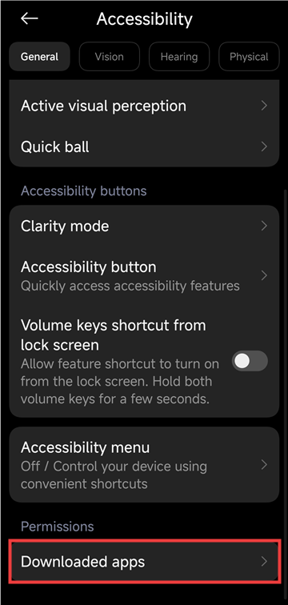
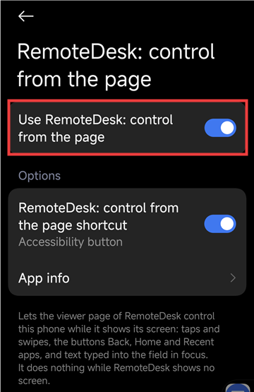

# RemoteDesk

See and control a computer or a phone from a browser: Windows, Linux, macOS and Android. Nothing to install on your side: the
page runs in Chrome or Edge, on a computer, a tablet or a phone. The connection is encrypted end to end.

Your own TeamViewer or AnyDesk: the same help at a distance, with no company in the middle. The remote computer runs one program,
a phone one app; you open one page; and the two meet by themselves: in one network, over the internet, through a meeting point
of your own, or straight.

| | TeamViewer, AnyDesk and the like | RemoteDesk |
|:--|:--|:--|
| Who connects the two | the servers of the company, by the ID of the device | nobody: they meet straight, or through a meeting point you run |
| What you get to connect | an ID and a password, from their service | a line the program prints, its token in it |
| On your device | their application | a page in Chrome or Edge, on a computer or a phone: one file, `RemoteDesk.html` |


## What it does

- **See and control.** The screen, the keyboard, the mouse, touch with up to ten fingers. A large screen pixel for pixel, or
  zoomed with two fingers.
- **Sound both ways.** What the remote computer plays, on your device; your microphone, on its speakers.
- **Clipboard both ways.** Text and pictures: copy on one side, paste on the other.
- **Files both ways.** Send them, or have its user pick one for you.
- **Draw over its screen.** Lines, rings, arrows that fade by themselves: show its user where to tap, instead of explaining.
- **Several at once.** Up to 8 viewers on one computer, one of them controls. One page holds several computers: tabs, a
  mosaic, floating, or windows of their own.
- **Phones, both ways.** A phone with Android is a remote computer like any other: shown, controlled, with its buttons Back,
  Home and Recent apps. And a phone is your device too: the page in its browser controls a computer.
- **No company in the middle.** The two meet straight, or through a meeting point you run; what passes between them is encrypted
  ([Noise](https://noiseprotocol.org/)), and only who has the token gets in.
- **The line by the camera.** The program shows its line as a QR code too: the page on a phone reads it, and keeps the computer
  by a name you give it, one press from connecting again.
- **A meeting point for other servers too.** The meeting point of way ③ can lead to Remote Desktop of Windows, SSH or any port
  instead: you connect with their own programs.

| Section | |
|:--|:--|
| [Quick start](#quick-start) | Download; control a computer, a phone, or from a phone |
| [Words used here](#words-used-here) | Remote computer, your device, token, key, meeting point |
| [How to connect](#how-to-connect) | Which way is yours; each way step by step, with pictures |
| [Your computers](#your-computers) | The QR code of the line read by the phone; computers kept by name, one press to connect |
| [When you connect](#when-you-connect) | Encryption, the key, the token |
| [In a session](#in-a-session) | The bar, drawing, several viewers, several computers |
| [Android](#android) | A phone as the remote computer, what to allow on it, a phone as your device |
| [The first start](#the-first-start), [Options of the program](#options-of-the-program) | |
| [Safety](#safety), [When something goes wrong](#when-something-goes-wrong), [Limits](#limits) | |
| [Building](#building) | For developers |

## Quick start

### Download

From the [latest release](../../releases/latest):

| For | File |
|:--|:--|
| The remote computer with Windows | [`rdp-host-windows-x64.zip`](../../releases/latest/download/rdp-host-windows-x64.zip) |
| The remote computer with Windows of 32 bits | [`rdp-host-windows-x86.zip`](../../releases/latest/download/rdp-host-windows-x86.zip) |
| The remote computer with Windows on ARM | [`rdp-host-windows-arm64.zip`](../../releases/latest/download/rdp-host-windows-arm64.zip) |
| The remote computer with Linux | [`rdp-host-linux-x64.tar.gz`](../../releases/latest/download/rdp-host-linux-x64.tar.gz) |
| The remote computer with macOS, Apple silicon | [`rdp-host-macos-arm64.tar.gz`](../../releases/latest/download/rdp-host-macos-arm64.tar.gz) |
| The remote computer with macOS, Intel | [`rdp-host-macos-x64.tar.gz`](../../releases/latest/download/rdp-host-macos-x64.tar.gz) |
| The remote phone or tablet with Android 10 or later | [`RemoteDesk.apk`](../../releases/latest/download/RemoteDesk.apk) |
| Your device: a computer, a tablet, a phone | [`RemoteDesk.html`](../../releases/latest/download/RemoteDesk.html): the page, one file |

Only Remote Desktop of Windows, SSH or another port through a meeting point, without RemoteDesk? The small scripts of
[SYN Mirror](https://github.com/AdHoc-Protocol/SynMirror#any-port-of-the-server) do that alone, nothing else to install: see
[The meeting point as a relay](#relay).

Unpack the program into a folder of its own: the library of encryption beside it is part of it. Or build them yourself:
[Building](#building).

### Control a computer

**1. On the remote computer**, double-click `rdp-host` (`rdp-host.exe` on Windows). Its window asks how you will connect: press
the number, the key alone is the answer.

```text
 🧭 How will the viewer reach this computer?

    1  🏠  From this network   the same home or office
    2  🌍  From the internet   this computer or its router has a public address
    3  🤝  Meeting point       SYN Mirror on a router of yours
    4  ⚡  Directly            nothing to set up

 Press 1, 2, 3 or 4 › 1  🏠 From this network
```

It shows one line to give whoever connects, in a frame: all the page needs is in it, the address, the port and, after `/`, the
token. The line is in the clipboard already: paste it into a message.

```text
 📨 Send this line to whoever connects:
    ╭───────────────────────────────────────────────────╮
    │  192.168.1.20:8765/K7QM2XHP9RTA4WZD8CNE-24NDRCK9  │
    ╰───────────────────────────────────────────────────╯
 📋 It is in your clipboard already: just paste it into a message.
 📷 Or scan it with a phone: 📷 beside the field of the line on the page.
    (the QR code of the line, dark on light)

 👀 Waiting for whoever connects…
 ✅ Anna from 192.168.1.30 is in · 1 watching
```

The window remembers the answer: next time Enter is enough. A meeting point is pasted once, in the one line the page of SYN Mirror
copies, `Tr7kQ2xZ@router.example.org:40000`, and offered again after that. What it remembers is in `rdp-host.settings` beside the program. The window stays open while the program runs:
closing it stops the program.

**2. On your device**, open `RemoteDesk.html` in Chrome or Edge. Press the number the remote computer pressed, paste the line
into the field on the arrow that comes from it, as it came: the page connects at once, nothing to press.



The page draws what happens, for the way chosen: your computer, the remote one, their routers, and what is between them, a house
for one network or the cloud of the internet. What it waits for is orange; what is on its way is blue, light running along the
line; what is done is green, the line alive with pulses both ways. A part that broke goes pale, its pulse stops, and the words
beside it say what to check. Under the picture, **What happens, in detail** opens the log of each step: the addresses, the times,
the answers of the STUN servers.

**Waited for.** Way ④: the STUN servers answered, your line flies there, its answer is waited for.


**On its way.** Way ③: the page dials the remote computer through the meeting point.


**Alive.** Way ④: the two met, straight through both routers, and the remote computer let you in.



**Broken.** Way ②: the router of the remote computer does not let the page in, and the page says what to check.



✗ The address alone is not enough: without the token the remote computer lets nobody in. Send the whole line, or the address
and the token both.

That is all when both are in one home or office. From another network, see [How to connect](#how-to-connect): there are four
ways, and a picture to choose.

### Control a phone

1. **On the phone**, install `RemoteDesk.apk` (Android asks once to allow apps from this source) and open it. Pick the way, as
   on a computer, and press **Show this screen**; in the window of Android pick **the entire screen**, then **Start**.
2. **The line** is in the clipboard of the phone at once; **Share** under it gives it to a messenger.
3. **On your device**, open the page, press the number of the way and paste the line: you see the phone.
4. **Once**, to control it and draw over it, its user allows two things in its settings: see
   [What to allow on the phone](#what-to-allow-on-the-phone).

### Control from a phone

Open `RemoteDesk.html` in Chrome on your phone or tablet, and paste the line of the remote computer, as on a computer. Or, beside
the remote computer, press **📷 Scan** on the field of the line and point the phone at the QR code the program shows under its
line: the page asks a name for it and keeps it, see [Your computers](#your-computers). The bar fits the narrow screen, your
fingers are touch, two fingers zoom: see [A phone as your device](#a-phone-as-your-device).

<a id="your-computers"></a>

### Your computers

The page keeps the computers you connected to, by a name you give each: **Mom's laptop**, **Office**. They are at the top of the
page, above the four ways; a press on one connects, the way and the line are its own.

| What | How |
|:--|:--|
| Add one | **📷 Scan** on the field of the line, the phone at the QR code in the window of the program. The page asks **Which computer is it?**: type a new name, or press one you have. A line of the same address is offered the name it had |
| Its new line | The program was started again: a new token, on way ③ a new port. **📷 Update** on the computer, the QR code read again: the same name, the new line. Or scan with **📷 Scan** and press its name |
| See its line | **Line** shows it under the name, and hides it again |
| Take it to your computer | **Copy**, or **Send** on a phone: to a messenger or to mail. On your computer, paste it into the page there |
| Another name | ✎ |
| Forget it | ✕ |

A line pasted by hand is kept too once the remote computer lets you in, under the name the remote computer tells; ✎ gives it
yours. The answer of way ④, `rd1a.…`, is for one meeting only: scanned, it goes into its field and connects, and is not kept.
The page keeps 20 computers, the last used first, in the browser it is opened in: another browser, or another device, has its
own.

**📷 Scan** shows the camera on the page where the browser lets it. A page opened from the Downloads of a phone is not let:
**📷 Scan** opens the camera app of the phone then, you take a photo of the code, and the page reads it on the photo. On a
computer without a camera it asks for a picture: a screenshot of the window of the program. The code is read by the reader of
the browser where it has one (Chrome on Android), else by the page itself.

## Words used here


| Word | What it means | Example |
|:--|:--|:--|
| **Remote computer** | The computer or the phone you want to see and control. The program `rdp-host` runs on a computer, the app `RemoteDesk.apk` on a phone | The laptop or the phone of a relative you help |
| **The app** | `RemoteDesk.apk`: the program of a phone with Android 10 or later | |
| **The user of the remote computer** | Whoever sits at the remote computer and starts the program there: its owner, you, or someone you help | Your relative |
| **Your device** | The computer, tablet or phone you control it from, in a browser | Your own PC, or your phone |
| **Token** | A word the program prints; only who gives it gets in. New at each start unless set | `K7QM2XHP9RTA4WZD8CNE` |
| **Key** | What proves the remote computer is the one you mean. Kept in `host.key` beside the program; its check is in the line, after the token and `-` | `24NDRCK9`, the check |
| **NAT** | The home router: it hides the computers of a home behind one address and lets in only answers to what they sent out | A Wi-Fi router |
| **Meeting point** | An OpenWrt router or a Linux server with [SYN Mirror](https://github.com/AdHoc-Protocol/SynMirror), reachable by both | A rented server |
| **STUN server** | A public server that tells a computer the address the internet sees it at, and nothing more. Way ④ asks several, in the world, in China and in Hong Kong | `stun.miwifi.com` |

## How to connect

The app on a phone offers the same four ways, as tiles: the steps are the same, with **Show this screen** in place of starting
the program, and the line in the clipboard of the phone and behind **Share**.


On ways ①-③, and on ④ with one line, your device dials the remote computer; with the two lines of ④ the two reach for each
other. Which way works depends on where the two are:

| Way | When | Set up | The line you paste on the page |
|:--|:--|:--|:--|
| [① The same network](#way-1) | One home, one office, one Wi-Fi | Nothing | `192.168.1.20:8765/K7QM2XHP9RTA4WZD8CNE-24NDRCK9` |
| [② From the internet](#way-2) | The remote computer has a public address, or its router forwards a port to it | A forwarded port | `203.0.113.7:8765/K7QM2XHP9RTA4WZD8CNE-24NDRCK9` |
| [③ Through SYN Mirror](#way-3) | Both behind NAT, nothing can be forwarded | A meeting point, once | `router.example.org:41933/K7QM2XHP9RTA4WZD8CNE-24NDRCK9` |
| [④ Direct](#way-4) | Both behind NAT, no meeting point | Nothing | `203.0.113.7:8765/K7QM2XHP9RTA4WZD8CNE-24NDRCK9` when the router of the remote computer opens a port; else `rd1a.…`, the answer of the program to the line of your page |

On every way the token is needed. On ways ①-③, and on ④ with one line, the line carries it after `/`: the whole line goes to the
page, as the program printed it. On way ④ with two lines the answer of the program carries it.

✓ To connect later, hours or days after the line was sent, the remote computer stays on and awake, the program running: asleep,
it lets nobody in, on every way. On Windows: **Settings > System > Power**, sleep **Never**. The screen may go dark: that does not
stop the program.

<a id="way-1"></a>

### ① The same network

1. **The user of the remote computer** starts `rdp-host` and presses **1**. It prints the line for this network, and puts it in the
   clipboard: `192.168.1.20:8765/K7QM2XHP9RTA4WZD8CNE-24NDRCK9`.
2. **They send you the line**, the token in it.
3. **You** press **1** on the page and paste the line on its arrow: the page connects.

When the computer is in several networks (a cable and Wi-Fi, a VPN), the program prints the address of one of them. The address
in the others:

- Windows: `ipconfig` in a terminal, the line `IPv4 Address`, such as `192.168.1.20`;
- Linux: `ip -4 addr`, the line `inet` of the Wi-Fi or the cable;
- macOS: System Settings > Network > the connection in use > Details.

✓ When Windows asks whether `rdp-host` may receive connections, the user of the remote computer allows it, for private networks.
✗ A guest Wi-Fi often keeps its devices apart: use the main one.

<a id="way-2"></a>

### ② From the internet

The remote computer is reached at a public address: its own, as a rented server has, or that of its router, which passes port
8765 on to it.

1. **On the router of the remote computer** (its web page, usually `http://192.168.1.1`): forward TCP port `8765` to the address
   of the remote computer, such as `192.168.1.20`. The menu is called Port Forwarding, Virtual Servers or NAT.
2. **The public address**: the router shows it on its status page, or any "what is my IP" site opened on the remote computer.
3. **The user of the remote computer** starts `rdp-host`, presses **2**, and allows it in the firewall, for public networks too. It
   asks a STUN server the public address, prints the line with it and puts the line in the clipboard. Without an answer it prints the line for the
   internet with `<public address>` in it: they put the address from step 2 there, `203.0.113.7:8765/K7QM2XHP9RTA4WZD8CNE-24NDRCK9`,
   and send you the line.
4. **You** press **2** on the page and paste the line on its arrow: the page connects.

✓ A server with a public address needs no router: only port 8765 open in its firewall.
✗ When the provider gives the router no public address of its own (CGNAT: the address on the router's page differs from the one
"what is my IP" shows), forwarding cannot work. Use way ③.

<a id="way-3"></a>

### ③ Through SYN Mirror

Neither the remote computer nor your device needs a public address or a forwarded port: only a meeting point both can reach, an
OpenWrt router or a Linux server with [SYN Mirror installed](https://github.com/AdHoc-Protocol/SynMirror#install). Its owner
gives the owner of the remote computer one line with everything: the password, the address, the port of requests, such as
`Tr7kQ2xZ@203.0.113.7:40000`. The page of SYN Mirror on the router copies it with one button, **Copy the meeting point**.

Why SYN Mirror, and not a relay server or a VPN:

| | A relay server, a VPN | SYN Mirror |
|:--|:--|:--|
| Forwarded ports at the homes | none | none |
| The video on its way | received and sent again by a program in the middle | passed by the kernel of the meeting point, like a forwarded port: no program in between |
| Load on the middle | high: every byte | as for a forwarded port: one record per connection, nothing copied: a weak router carries many |
| What the middle needs | a server sized for the traffic | a small Linux server, or the OpenWrt router of a home with a public address |
| Speed | the program of the relay can be the slowest part | only the network to the meeting point and from it: nothing waits for a program |

**On the remote computer**, the program is started, and **3** pressed. It asks what the meeting point leads to: **1**, RemoteDesk,
is what this section shows; **2**, Remote Desktop of Windows, and **3**, another port, are in
[The meeting point as a relay](#relay). The first time its window asks the meeting point, as its
owner gave it: one line, the password, `@`, the address, `:`, its port of requests, as the page of SYN Mirror on the router copies it with its button
**Copy the meeting point**. Pasted, nothing else is asked; it is remembered, and next time Enter is enough. An address alone is
taken too: then the window asks the password. From a console or a script the same is:

```text
rdp-host --meet Tr7kQ2xZ@router.example.org:40000
```

On the phone, the line goes into the field of the meeting point: the password moves to its own field by itself.

It shows a line to send to you, and waits for you at once:

```text
 📨 Send this line to whoever connects:
    ╭──────────────────────────────────────────────────────────╮
    │  router.example.org:41933/K7QM2XHP9RTA4WZD8CNE-24NDRCK9  │
    ╰──────────────────────────────────────────────────────────╯
 📋 It is in your clipboard already: just paste it into a message.

 👀 Waiting for whoever connects…
```


| Step | Who | What happens |
|:--|:--|:--|
| | The user of the remote computer | Starts `rdp-host` and presses **3**: the first time it pastes the meeting point, its password and address in one line |
| ① | The program | Sends the password and its id, 8 random bytes of this start, to the port of requests of the meeting point, and gets a port nobody else holds: `41933` in the line. The port is given to the id, not to an address: only knocks with it open the port |
| ② | The program | Prints the line, and puts it in the clipboard |
| ③ | The program | Knocks at the port, the password and the id, and dials it, every second, from then on. It dials out, so its own NAT lets the answer in |
| ④ | The user of the remote computer | Sends you the line, the token in it, by chat or mail |
| ⑤ | You | Press **3** on the page and paste the whole line on its arrow, as it came: the page connects |
| ⑥ | The meeting point | Joins the two attempts into one connection, in its kernel. From then on it passes the data like a forwarded port |
| ⑦ | The page and the program | The key, the token, then the screen: see [When you connect](#when-you-connect). The meeting point reads nothing: the data is encrypted between the two |

After each meeting the program knocks again and waits at the same port. If the connection breaks, the page dials the same
line again and meets the remote computer there; a second viewer uses the same line too. A new start of the program gets a new
port, and so a new line.

The line works as long as the program runs: days, weeks, with nobody at the remote computer. The program needs nothing more after
its start, and nobody presses anything there. Two things end the line:

- **The program stops**, or **the remote computer sleeps**. The meeting point keeps the port for a minute after the last knock
  (the setting Wait of SYN Mirror), then gives it to others. Turn sleep off on a computer that is to wait for you: on Windows,
  **Settings > System > Power**, sleep **Never**. The screen may go dark: that does not stop the program.
- **The meeting point restarts**, or its password changes.

A new address of the remote computer does not end it: the port is given to the id the program sent, and its knocks open the port
from any address. Nor does a NAT that gives the remote computer another port for each packet.

✓ The user of the remote computer sends the line in a private message: whoever has it can try the token in it.

How the meeting point lets the connection through both NATs is shown in the
[README of SYN Mirror](https://github.com/AdHoc-Protocol/SynMirror#how-it-works).

<a id="relay"></a>

#### The meeting point as a relay

The meeting point can lead to another server of the remote computer, or of its network, instead of RemoteDesk: Remote Desktop of
Windows, SSH, a VNC server. You use the program of that server, not the page; the program `rdp-host` on the remote computer only
joins whoever comes through the meeting point to that server, and passes the bytes as they are. Neither the page, nor the token,
nor the key of RemoteDesk takes part: the server there checks who comes.

```text
 🤝 Use SYN Mirror as a relay to:
    1  🖥️  RemoteDesk                 the page of RemoteDesk, as on the other ways
    2  🪟  Remote Desktop of Windows  Remote Desktop Connection ( mstsc ): a long, strong password on the account is a must
    3  🔌  Another port               of this computer or of its network: you type which
```

| Press | It leads to | You connect with |
|:--|:--|:--|
| **1** | RemoteDesk | The page, as above |
| **2** | Remote Desktop of Windows, port 3389 of the remote computer | **Remote Desktop Connection** (`mstsc`) of your computer: as **Computer**, the line the program shows, `router.example.org:41933` |
| **3** | The port typed: `22` - of the remote computer -, or `192.168.1.5:5900` - of its network | The program of that server: `ssh -p 41933 router.example.org`, a VNC viewer at `router.example.org:41933` |

From a console or a script the same is `--forward`:

```text
rdp-host --meet Tr7kQ2xZ@router.example.org:40000 --forward 3389
```

The program then shows the line without a token, `router.example.org:41933`, and waits, as on way ③: after each connection it
waits again at the same port, for the next one or the same after a break.

✓ For **2**, Remote Desktop is on: Windows Pro or above, **Settings > System > Remote Desktop**. Windows Home has none: use **1**.
The program says at its start when nothing answers at port 3389.
✓ The account you log in with has a password: Remote Desktop lets in no account without one. A long one: see below.
✓ The remote computer stays on and awake while you may connect: asleep, it lets nobody in.
✗ The port of meeting is open all the time the program waits, and Remote Desktop Connection cannot knock: whoever dials that
port reaches the login of Windows, as with port 3389 forwarded on a router. Expect guessing: programs of the internet try every
port of every address, and on one that answers as Remote Desktop they try names and passwords, thousands of them, day and night.
The password is all that stops them:

- a long password of its own for the account, 16 characters or more, or four or five random words, used nowhere else;
- no account named Administrator, admin or user to log in with: those are guessed first;
- the line kept private, and the program stopped when nobody needs it.

The meeting point helps: a refused password is a short connection, and SYN Mirror blocks an address with more than 5 of them at
that port, in its kernel ([Guard against guessing](https://github.com/AdHoc-Protocol/SynMirror#guard-against-guessing)). That is
the second line of defense; the password is the first.

**Only the relay, no RemoteDesk at all.** When nobody needs the page of RemoteDesk, only Remote Desktop of Windows, SSH, VNC or
another port through the meeting point, SYN Mirror has scripts of its own for the remote computer, the server in its words: one
script and nothing else, the program `rdp-host` not needed. Windows PowerShell of Windows runs the one, the perl of Linux and
macOS the other. They ask the same - what to open, then the meeting point -, show the same line `router.example.org:41933` and
join whoever comes the same way, the bytes as they are:

| The remote computer | Download, from the releases of SYN Mirror | Start |
|:--|:--|:--|
| Windows | [`syn-mirror-server-windows.zip`](https://github.com/AdHoc-Protocol/SynMirror/releases/latest/download/syn-mirror-server-windows.zip): unpack it into a folder | A double click on `syn-mirror-server.cmd` |
| Linux, macOS | [`syn-mirror-server.pl`](https://github.com/AdHoc-Protocol/SynMirror/releases/latest/download/syn-mirror-server.pl) | `perl syn-mirror-server.pl` |

```text
 🔌 What should the other computer reach through the meeting point?

    1  🪟  Remote Desktop of Windows  port 3389 · Remote Desktop Connection ( mstsc ): a long, strong password on the account is a must
    2  🔐  SSH                        port 22 · ssh -p <port> <meeting point>
    3  🖼️  VNC                        port 5900 · a VNC viewer
    4  🌐  A web server               port 80 · a browser: http://<meeting point>:<port>
    5  ✏️  Another port               of this computer, or address:port of its network: you type which
```

| | `rdp-host`, **3**, then **2** or **3** | The scripts of SYN Mirror |
|:--|:--|:--|
| What is on the remote computer | The program of RemoteDesk | One script, of a few hundred lines you can read |
| RemoteDesk itself | The same program, **1** on another start | Not there |
| The line, the QR code | The line in a frame and as a QR code | The line in a frame |

Both keep the answers of the menu, put the line in the clipboard, wait again at the same port after each connection, and need
the computer awake; to both the warning above holds: a strong password. How each works, and its own options: the README of SYN Mirror, [Any port of the server](https://github.com/AdHoc-Protocol/SynMirror#any-port-of-the-server).

<a id="way-4"></a>

### ④ Direct

Both behind NAT, and no meeting point: the page and the program meet straight, with nobody in between. Nothing to install,
forward or rent.

**On the remote computer**, the program is started, and **4** pressed. From a console or a script the same is:

```text
rdp-host --direct
```

How many lines it takes depends on the router of the remote computer:

| The router of the remote computer | Lines | |
|:--|:--|:--|
| Opens a port to the program when it asks, and has a public address | One: `address:port/token`, as on way ② | [One line](#way-4-one) |
| Opens none, or has no public address of its own | Two: `rd1o.…` there, `rd1a.…` back | [Two lines](#way-4-two) |

The program finds out by itself in a few seconds after its start, and says which it is.

<a id="way-4-one"></a>

#### One line: the router opens a port

The program asks its router to forward port 8765 to it: the forwarding of way ② that a person sets up by hand, done by the
program. It speaks the three protocols routers take such requests in: UPnP, which most home routers speak, NAT-PMP and PCP. Then
it checks the address the router has: a public one, not a NAT of the provider before it. When both hold, it shows the line of
way ②:

```text
 📨 Send this line to whoever connects:
    ╭──────────────────────────────────────────────────╮
    │  203.0.113.7:8765/K7QM2XHP9RTA4WZD8CNE-24NDRCK9  │
    ╰──────────────────────────────────────────────────╯
 📋 It is in your clipboard already: just paste it into a message.

 🔁 If that line does not connect: paste here the line from the page ( rd1o.… ), then Enter
```

1. **The user of the remote computer** sends you the line from the internet, the token in it: the program has put it in the
   clipboard.
2. **You** press **2** on the page, as the line is the one of way ②, and paste it there: the page connects. That is all: the rest
   is as on way ②. On **4** the field of the answer shows only once the page made its own line.

The router keeps the port for an hour, and the program asks for it again every half hour while it runs. When the program is
closed, by Ctrl+C or its window, it closes the port. A program that stops without closing loses the port within the hour; a
router that keeps ports only for good keeps it until it restarts. When the router gives another port, after its restart, the
program prints the new line.

✓ When Windows asks whether `rdp-host` may receive connections, the user of the remote computer allows it, for public networks
too.
✓ A router that answers nothing has UPnP turned off: its web page, usually `http://192.168.1.1`, has a switch for it, often under
Advanced or NAT. Or the two lines do without it.
✗ From the same network, the line from the internet may not connect: many routers do not pass their own address back inside.
Use the line for this network there.

When the router opens no port, or its own address is not public (a NAT of the provider before it), the two lines are the way.

<a id="way-4-two"></a>

#### Two lines: the page and the program meet over WebRTC


The page and the program meet over WebRTC, as a video call in a browser does. The browser has WebRTC built in, the program
carries its own, and the STUN servers they ask are public and free. A STUN server only tells a computer the address the internet
sees it at: the screen and the input go straight between the two.

What the two need to know of each other goes in two short lines, by hand, through any messenger:

| Line | Made by | What is in it | Length |
|:--|:--|:--|:--|
| `rd1o.…` | The page, when you press **Make the line** | The addresses the STUN servers saw your device at; the name and password of the page for this meeting; the fingerprint of its certificate | About 110 characters |
| `rd1a.…` | The program, when its user pastes the line of the page | The same of the program, and its address in its own network; the token | About 160 characters |

Each address adds about 10 characters.

The address of your device in its own network is not in the line of the page: the browser hides it. Each line holds up to a few
addresses: a computer whose traffic goes out by several ways (a VPN for some sites) is seen by the servers at several, and each
is tried.

**The STUN servers.** Not each one is reached from everywhere: Google is closed in mainland China, a server in China may be slow
abroad or gone. Both sides ask several, and go on with the ones that answer:

| Where | The program asks | The page asks |
|:--|:--|:--|
| All over the world | Google, Cloudflare, Twilio, Nextcloud, sipgate | Google, Cloudflare |
| Mainland China | Xiaomi, Bilibili, Mango TV, Douyu, Tencent | Xiaomi |
| Hong Kong | Amazon (region ap-east-1) | Amazon (region ap-east-1) |

- The program asks all of its 11 when it starts, and keeps the ones that answer, the nearest first. At each meeting it asks only
  them, again: the address the internet sees depends on the socket, and each meeting has its own.
- The page asks its four at once each time you press **Make the line**, and waits for them 4 seconds at most. It has fewer:
  from five servers on, a browser slows down its search.

The program, when its router opened no port:

```text
 📥 Paste here the line from the page ( rd1o.… ), then Enter
 💡 On the page: 4, then Make the line - it goes into the clipboard there
```

| Step | Who | What happens |
|:--|:--|:--|
| | The user of the remote computer | Starts `rdp-host` and presses **4**. The program asks its 11 STUN servers, and waits for the line of the page |
| ① | You | Press **4** on the page, then **Make the line** on the arrow ①. The browser asks the four STUN servers of the page the address of your device: on the picture each of them gets ✓, or goes pale with ✕ |
| ② | You | The page puts its line `rd1o.…` in the clipboard: send it to the user of the remote computer, by chat or mail. When the browser does not let it in, press **Put it in the clipboard** |
| ③ | The user of the remote computer | Pastes it into the window of the program and presses **Enter**. The program asks the STUN servers that answered at its start, and prints its answer `rd1a.…`, the token in it, and puts it in the clipboard |
| ④ | The program | From then on sends a short packet to the addresses of the page every second: its own NAT opens for them, and lets the page in |
| ⑤ | The user of the remote computer | Sends the answer back to you from the clipboard, in a private message. Within 15 minutes: the program waits for the page that long |
| ⑥ | You | Paste the answer on the arrow ②, on the same page: the page connects; reloaded, it forgets what the answer goes with. The page waits for the meeting a minute |
| ⑦ | The page and the program | Meet: ICE tries the addresses of both lines, pair by pair, and finds a way through both NATs; DTLS encrypts it; a data channel opens |
| ⑧ | The page and the program | The key, the token, then the screen: see [When you connect](#when-you-connect) |

```text
 ✅ The answer is ready
 📨 Send this line to whoever connects:
    ╭───────────────────╮
    │  rd1a.ERBmeVBk…   │
    ╰───────────────────╯
 📋 It is in your clipboard already: just paste it into a message.

 🤝 Met the page: straight, through both routers
```

Each pair of lines serves one connection. A second viewer, or the same one after the connection breaks, presses **Direct
connection** again and sends the new line: the program reads lines in its window as long as it runs, and each one gets its own
answer and its own meeting.

The two lines work in one network too: the answer carries the address of the remote computer there. Way ① is simpler there.
With `--direct` the program waits at `--listen` for ways ① and ② all along: it prints their lines when its router opened a port.

✓ The user of the remote computer sends the answer in a private message: it carries the token.
✗ A phone in a mobile network and a router that lets in only what it asked for leave no straight way: the network of the phone
gives it a new port for each address, and the router drops what comes from a port it did not write to. Two symmetric NATs leave
none either. Both sides are known before anything is tried: the page tells of its network when it makes its line, the program
tells of its router at its start (STUN servers that answer from another address of theirs show it), and once the answer is
pasted the page says at once that the two will not meet. Use way ③ then.

## When you connect


The same on every way:



The line carries a check of the key of the remote computer: after the token, `-` and 8 characters, the first 40 bits of the
SHA-256 of the key. The page checks the key the computer proves against it in the handshake, before the token goes: another computer
answering at that address does not fit, and gets no token. The page says `Not the computer of the line`, and the picture shows it
at the remote computer. Nothing to compare by hand: the line, sent by the user of the remote computer, is the proof.

A line without the check, typed by hand: the page keeps the key it saw first at that address, and refuses another one there later.
If the remote computer got a new key on purpose (a new `host.key`), press **Forget the key of this machine** once; a line with the
check needs none of that, it tells the new key.

## In a session


The bar of the page, on your device, lies over the top of the screen of the remote computer. Pull it up by its handle, the
short tab with three lines under it, or press the handle: the bar hides, and the whole screen is yours; pull or press it again to
bring the bar back. The page remembers where you left it.

On the left: a dot (green, you control; blue, you watch; yellow, the connection is dialed again), the name of the computer, and who
watches and who controls. **Take control** shows there when you only watch. On the right the buttons, an icon each, what it does
in the hint of the mouse:

| Button | What it does |
|:--|:--|
| ◁ ○ □ | A phone only: its buttons Back, Home and Recent apps |
| ⌨ | A device with a touch screen only: shows or hides its keyboard on the screen. A touch on the screen does not bring it up |
| ✏️ | Your mouse or finger draws over the screen of the remote computer instead of controlling it: see [Drawing over the screen](#drawing-over-the-screen). While it is on, ➚ draws arrows and the round button changes the colour |
| 🔊 | Turns the sound of the remote computer on or off on your device. Off when you connect |
| 🎤 | Plays your microphone through the speakers of the remote computer. Off when you connect |
| ⬆ | Sends files from your device to the Downloads folder of the remote computer. You can also drop them on the screen |
| ⬇ | The user of the remote computer picks a file, and the page saves it on your device |
| **Whole / 1:1 / %** | Whole: the screen of the remote computer fits your window. 1:1: a pixel of it is a pixel of your screen, its text as large as there - for a large screen seen from a small one. Bring the pointer, or a finger, to an edge of the window: the view goes that way. Two fingers apart or together zoom the view about the point between them, as in AnyDesk; two fingers that move together move a view zoomed or at 1:1, and scroll on the remote computer when the whole screen is in view. Pressed after a zoom: the whole screen again. Whole and 1:1 are kept for the next time |
| ⛶ | Full screen: Alt+Tab, the Windows key and other keys of the system go to the remote computer too |
| ⋯ | The menu of what is set once in a while, below |
| Red plug | Disconnects |

The menu of ⋯:

| Item | What it does |
|:--|:--|
| The numbers at the top | The size of the frames, frames a second, the speed of the network, how long the capture and the encoding take |
| The list of displays | Shows another display of the remote computer. The display its user works on is marked |
| **Fit** | The resolution of the remote computer follows the size of your window. Turning it off, or leaving, restores it |
| **30 fps** | Switches to 60 frames a second and back: 60 is smoother, and takes twice the network and more of the remote computer. The page remembers the choice |
| **Lock pointer** | Your mouse moves the pointer of the remote computer without limits, for games and 3D. **Esc** frees it |
| **Ask for admin rights** | Windows: the user of the remote computer is asked to confirm. Then you can work in programs run as administrator too |

On a narrow screen, a phone, the bar has no room for the files and the full screen: they are in the menu of ⋯ as well, and the
name of the computer is in the hint of the dot.

Also:

- **Keyboard.** The keyboard layout of the remote computer applies, as if your keyboard were plugged into it.
- **Clipboard.** Copied text and pictures go both ways: a picture as PNG, up to 16 MB. Copy a picture on your device and press
  **Ctrl+V** on the page: it is on the clipboard of the remote computer, and pasted where its focus is. The browser asks once for
  permission to read the clipboard.
- **Touch.** Up to ten fingers on Windows and on Linux with Wayland.
- **Reconnection.** When the connection breaks, the page tries again 10 times, from 1 to 30 seconds apart.
- **Hidden tab.** While the page is in a background tab or a minimized window, the remote computer sends no video and spends
  nothing on it. The picture comes back when you return.
- **Slow network.** The picture gets coarser instead of lagging: the remote computer lowers the quality when the network falls
  behind, and raises it again when the network keeps up.

### Drawing over the screen

To show the user of the remote computer where to tap or which field to fill, draw on its screen instead of explaining. Press
**✏️** in the bar: while it is on, your mouse or finger draws, and the remote computer gets no input.

| You | The user of the remote computer sees |
| --- | --- |
| Draw a line | The line, over every window, as you draw it |
| Tap or click | A ring there, rippling: here |
| **➚ Arrow** on, then draw | An arrow from where you began to where you let go |
| **●** | Changes the colour: red, yellow, green, blue |

Each mark holds a moment and fades by itself in about 2.5 seconds. The marks let the mouse and the touches through: the user goes
on working under them. You see them in the picture as the user does. Every viewer can draw, not only the one who controls.

A value to type goes the way of the clipboard: copy it on your device and press **Ctrl+V** on the page, then the user pastes it
into the field the mark shows.

| Remote computer | The marks |
| --- | --- |
| Windows, macOS | Shown over everything |
| Linux with X11 | Shown when a compositor runs (GNOME, KDE and most desktops have one) |
| Linux with Wayland | Not shown: Wayland lets no program put a window over the others |
| Android | Shown over the other apps once its user allows **Display over other apps**: the app has a button for it |

### Several viewers

Up to 8 devices with the token are in at once, each with the display it chose. All see, one controls:



The bar shows how many watch and who controls. The one who comes in controls at once; the others watch, and take the control back
with **Take control**. The keyboard, the mouse, **Fit**, the microphone, the clipboard and the files reach the remote computer only
from the one who controls. The remote computer prints who comes in and who leaves.

### Several computers at once

One page connects to several remote computers at once, a tab each, and lays them out as you like:

| What you do | What happens |
| --- | --- |
| **+** at the right of the tabs | The form comes back: paste the line of another computer, and it opens in a tab of its own beside the ones there. **← Back to the computers connected** returns without connecting |
| Drag a tab to an edge of another computer | The screen splits: the two side by side or one above the other. Drag more, and they tile the page as a mosaic; the borders between them move |
| Drag a tab onto the tabs of another group | It joins them |
| **▣** | The group floats over the others, anywhere on the page, any size. **▣** once more puts it back among them |
| **⧉** | The computer goes into a browser window of its own: put it on another monitor, beside other programs. Closed, it comes back as a tab. A browser that blocks it says so: allow pop-ups for the page |
| ✕ on a tab | Disconnects that computer |

A tab shows the name of its computer, with ⟳ while the connection is lost and dialed again.

Only the computers you see send their screens: one behind the tab of another, or under the form, neither captures nor
encodes, and its connection carries no video. It stays connected and shows its screen at once when its tab is pressed.

## Android

### A phone as the remote computer


`RemoteDesk.apk` from the release shows the screen of a phone or a tablet with Android 10 or later to the same page. Install it
(Android asks to allow apps from this source once), open it, pick one of the four ways, as on a computer, and press **Show this
screen**. Android asks whether to show the screen: RemoteDesk asks for the whole screen. While it shows, a notification says so;
**Stop** there, or in the app, ends it.

The line to send is in the clipboard of the phone at once, and **Share** under it gives it to a messenger. **Details** unfolds
what the app says of each step. Way ③ waits for you at once, way ④ for the answer of the page, pasted into the app.

What the phone does in this version:

| What | How |
| --- | --- |
| The screen | Encoded by the hardware of the phone, of the size the encoder takes. Turned, the phone is shown turned |
| The sound | What the apps play, when they let it be captured: music, video, games. Calls never. Android asks for the permission of the microphone for it |
| Your fingers and mouse | Taps, swipes, drags, a long press, two fingers: as you make them, not after. The left button is a finger, the right one **Back**, the middle one **Home**; the wheel scrolls |
| The buttons of the phone | **◁ ○ □** in the bar of the page: Back, Home, Recent apps. **Esc** is Back too |
| Your keyboard | What you type goes into the field in focus on the phone, in any language: the page sends the characters, not the keys. Enter, Backspace, Delete, the arrows, Home, End work in the field from Android 13; before it Enter, Backspace and Delete |
| Your microphone | **Microphone** on the page: the phone plays it on its speaker. The app keeps its own sound out of the sound it sends, so your voice does not come back |
| Text and pictures from the computer | **Ctrl+V** on the page pastes them into the field in focus on the phone, a picture as the app there takes one (a messenger does). Without the control: they are on the clipboard of the phone, tap a field, hold, **Paste** |
| Text and pictures to the computer | **Ctrl+C** or **Ctrl+X** on the page copies on the phone, and what it copied goes to the clipboard of the computer at once. The user of the phone sends them too: text selected in any app, **To the computer** in the menu of the selection; text or a picture shared to RemoteDesk, from the gallery as well; or anything copied, **Send the clipboard** in the notification. Paste them on the computer |
| Files from the computer | Into the folder of the app: `Android/data/org.unirail.RemoteDesk/files/Download` |
| Files from the phone | **Get a file** on the page: the phone shows its picker, its user picks the file, and the page saves it |

Android lets an app read the clipboard only while the app is in front, so the phone sends text when you send it, not by itself.

To be controlled from the page and to show the marks, the phone asks its user once for two permissions: see
[What to allow on the phone](#what-to-allow-on-the-phone). Until then it only shows its screen, and the bar of the page says
**✋ The phone does not let you control it yet**; it goes as soon as the user turns the control on.

While RemoteDesk shows the screen, the screen of the phone stays on: Android stops showing it when the phone locks. Locked
anyway, or stopped from the bar of the system, the phone says so in a notification: open RemoteDesk and show the screen again.

### What to allow on the phone


| What | What for | When |
| --- | --- | --- |
| Showing the screen | The picture. In the window of Android pick **the entire screen** (not a single app), then **Start** | At each start: Android asks every time |
| Microphone, notifications | The sound the apps play (Android grants it as the microphone); the notification that the screen is shown | Once, at the first start |
| Display over other apps | The marks the viewer draws | Once: **Allow** beside **Marks over the screen** in the app opens the page, turn RemoteDesk on there |
| Accessibility: **RemoteDesk: control from the page** | Taps, swipes, the buttons of the phone, typing | Once: below |

The app shows what is not allowed yet under **Finish the setup, once**, and hides it when all is. Some phones, Xiaomi among them, turn
the control off when a new version of the app is installed: the row shows again, turn it on as the first time. **Turn on**
beside **Control from the page** opens **Accessibility**. Android lets an app control the others only as a
service of accessibility, and every maker puts the list of such services in another place:

1. Scroll **Accessibility** to the end, to the list of the services of the apps installed. On a Xiaomi it is **Downloaded apps**
   under **Permissions**:

   

2. Tap **RemoteDesk: control from the page**, turn **Use RemoteDesk: control from the page** on, and allow it in the window
   that comes:

   

   The switch of the shortcut below it is not needed: it only puts a button of accessibility on the screen.

3. The switch is grey, and Android says the setting is restricted: an app installed from a file must be let first. Open
   **Settings → Apps → RemoteDesk**, tap **⋮** at the top right, **Allow restricted settings**, and go back to step 1.

Where the list is, by the maker:

| Phone | The list of services in Accessibility |
| --- | --- |
| Xiaomi, Redmi, POCO (HyperOS, MIUI) | Tab **General**, at the end: **Permissions → Downloaded apps** |
| Google Pixel, Motorola, Nokia: Android as Google makes it | **Downloaded apps** (Android 12 and before: **Installed services**) |
| Samsung (One UI) | **Installed apps** |
| OnePlus, OPPO, realme (OxygenOS, ColorOS) | **Downloaded apps** |
| vivo (OriginOS, Funtouch OS) | **Installed services** |
| Honor, Huawei (MagicOS, EMUI) | **Installed services** |

The path of Xiaomi is the one of HyperOS on Android 16; the others are named as their systems name them, and a version of a
system may move them. Not found: the search of **Settings** (the magnifier at the top) finds them by these words:

| To find | In English | По-русски |
| --- | --- | --- |
| The service itself | RemoteDesk | RemoteDesk |
| The list of services | Downloaded apps, Installed services, Installed apps | Скачанные приложения, Загруженные приложения, Установленные службы |
| The grey switch | Allow restricted settings | Ограниченные настройки |
| The marks | Display over other apps | Поверх других приложений |

Or press **How on this phone?** under the row in the app: the browser of the phone searches the web for how to do it on that
phone, its maker and its Android in the words of the search, in the language of the phone.

### A phone as your device

The page works in Chrome on a phone or a tablet as on a computer: download `RemoteDesk.html` from the release on it and open it in
Chrome, then paste the line of the remote computer.

| On your phone | On the remote computer |
|:--|:--|
| Tap, drag, a long press | Touch on Windows and on Linux with Wayland; the mouse on macOS and on Linux with X11 |
| Tap, then at once touch and hold at the same place | The right button there: the menu of what the tap chose |
| Two fingers moving together | The view zoomed or at 1:1: move it on your phone. The whole screen in view: scroll there |
| Two fingers apart or together | Zoom the view on your phone, not the remote computer |
| A finger at an edge, the view at 1:1 or zoomed | The view goes that way |
| Tap the field, ⌨ in the bar, then type | The keyboard of the phone comes up and types text where the remote computer has its cursor; ⌨ again hides it. The screen goes up with the keyboard, as large as it was: the field you tapped stays above it. A touch on the screen does not bring the keyboard up |
| ✏️, then a finger | Draws over its screen |

The bar fits the narrow screen: the files and the full screen are in its menu ⋯, and its handle hides it, so the whole screen of
the phone is the remote one. Keys the keyboard of a phone has not (Ctrl, Alt, the Windows key, Esc, F1-F12) cannot be pressed
from a phone yet.

## The first start


On some systems the user of the remote computer allows screen sharing once:

| System of the remote computer | What its user does |
|:--|:--|
| Windows | Nothing. When Windows asks whether `rdp-host` may receive connections, allows it |
| Linux with X11 | Nothing |
| Linux with Wayland | Allows sharing the screen and the input in the dialog of the desktop. The answer is remembered |
| macOS | Turns on **Screen Recording** and **Accessibility** for the program in System Settings > Privacy & Security, then starts it again |
| Android | Allows showing the screen at each start: Android asks every time. Once: turns on the control in the settings of accessibility, and lets the app display over the others for the marks |

## Options of the program


Started without options, by a double click, the program asks in its window what it needs, and remembers the answer in
`rdp-host.settings` beside it. With options it asks nothing: for a console, a script or a service.

| Option | Default | What it does |
|:--|:--|:--|
| `--listen <address:port>` | `0.0.0.0:8765` | Where the program waits for the page: ways ① and ② |
| `--token <token>` | variable `RDP_TOKEN`, else new at each start | The token the page must give |
| `--key <file>` | `host.key` beside the program | The key of the remote computer: the page recognizes the computer by it |
| `--software` | | Encode the video on the processor even when the graphics card can (Windows). A screen larger than 4096 pixels a side is sent at half its size |
| `--meet [<password>@]<meeting point>[:<port>]` | port `40000` | Way ③: meet the page through this meeting point with SYN Mirror, as the page of the router copies it. Before `@` its password; after `:` its port of requests, when it is not 40000 |
| `--meet-password <8 characters>` | variable `RDP_MEET_PASSWORD` | The password of that meeting point, when `--meet` has none |
| `--forward <port>` or `--forward <address:port>` | | With `--meet`: the meeting point leads to this port of the remote computer, such as `3389`, Remote Desktop of Windows, or to address:port of its network, not to RemoteDesk. See [The meeting point as a relay](#relay) |
| `--direct` | | Way ④: first asks the router to open the port of `--listen` to this computer, for one line; else meets the page over WebRTC, its line pasted into the window of the program. The program waits at `--listen` for ways ① and ② all along. Not together with `--meet` |

Examples:

```text
rdp-host --token MySecretToken2026          the same token at every start
rdp-host --listen 192.168.1.20:9000         only in the local network, on port 9000
rdp-host --meet Tr7kQ2xZ@router.example.org:20000    a meeting point whose port of requests is 20000
```

## Safety


- Only someone with the token gets in. After 5 wrong tokens in a row the remote computer lets nobody in for a minute.
- The lines with the token go through the clipboard. A clipboard history (Windows: Win+V) or a clipboard shared between devices
  keeps them; the token is new at each start of the program unless set with `--token`.
- The page keeps [your computers](#your-computers) in its browser, their lines with the tokens: whoever uses that browser connects
  with them while the program there runs with the same token. ✕ forgets one.
- `rdp-host.settings` beside the program keeps the password of the meeting point as plain text, apart from its address, and never
  the token. Whoever can
  read the folder of the program can read it.
- The page checks the key of the remote computer: another key at an address it knows is refused, someone else may be answering
  there.
- Everything between your device and the remote computer is encrypted ([Noise](https://noiseprotocol.org/)): the routers on the
  way and the meeting point of SYN Mirror pass it without reading it.
- With `--forward` the meeting point leads straight to the server named: whoever dials the port of meeting reaches it, with no
  token of RemoteDesk. Its own login is all that guards it, and it will be guessed at: for Remote Desktop of Windows a long
  password of its own, 16 characters or more; see [The meeting point as a relay](#relay).
- With SYN Mirror the port of meeting is given to the id of the program alone: 8 random bytes, new at each start. Whoever
  reaches the port still needs the token.
- On way ④ with one line the router opens the port of the program to the internet while the program runs, as on way ②: only
  someone with the token gets in, and the port is closed with the program.
- On way ④ with two lines the answer of the program carries the token: it goes only to the one who sent the line. The STUN
  servers learn the addresses of the two and nothing more: what passes between them goes straight, encrypted twice, by DTLS and
  by Noise inside it.
- A phone: the app controls it only while it shows its screen, and only for the viewer with the token. Its service of
  accessibility does nothing else, and its user turns it off in the settings any time.
- A phone: the app keeps its own sound out of the sound it sends, so the microphone of the page does not come back to the page.

## When something goes wrong


What the page says, under the picture, beside its parts, or in its bar:

| The page says | Why | What to do |
|:--|:--|:--|
| `The machine does not answer` | The remote computer is not reachable at that address, or the program is not running there | Check the address and the port. From another network use way ②, ③ or ④ |
| `Refused: a wrong token.` | The token does not match | Copy the token again, or the whole line of way ③ |
| `Refused: too many wrong tokens` | 5 wrong tokens in a row | Wait a minute |
| `Refused: the machine has as many viewers as it takes.` | 8 viewers are in | Wait until one leaves |
| `The machine answers with another key` | The remote computer got a new key file, or another computer answers at that address | If the key changed on purpose, press **Forget the key of this machine** |
| `That is not a line of the remote computer: …` | Something else was pasted on the arrow | Paste the whole line the program printed, such as `192.168.1.20:8765/K7QM2XHP9RTA4WZD8CNE-24NDRCK9` |
| `The token is missing: …` | Only the address is there, without `/` and the token | Paste the whole line the program printed |
| Way ③: the page does not get in, the program waits | The line is of an earlier start, or the remote computer slept a minute or more and the meeting point gave its port away | The user of the remote computer starts the program again and sends the new line; turns sleep off |
| Way ③: the program says `no port of meeting` | A wrong password or port of requests, or its address is blocked by the meeting point for wrong passwords | Copy the line of the meeting point again, from the page of its router: its password or port may have changed; see [SYN Mirror](https://github.com/AdHoc-Protocol/SynMirror#when-something-goes-wrong) |
| `Direct connection: this device and the remote computer will not meet directly` | The network of your device gives it a new port for each address, as a mobile network does, and the router of the remote computer lets in only what it asked for. Found before the meeting: the page when it made its line, the program at its start | Use way ③; or your device on Wi-Fi; or open a port to the remote computer on its router |
| `Direct connection: the remote computer answered none of the checks` | Its router, or a firewall on it, lets in nothing it did not ask for. Above it in the log: each address of the remote computer, the checks sent there and the ones answered | Use way ③; or open a port to it on its router |
| `Direct connection: the checks of the remote computer came, none of its answers did` | Something on the way lets only one direction through | Use way ③ |
| `Direct connection: the addresses met, the encrypted channel did not open` | The program gave this meeting up: it was stopped, 15 minutes passed, or the answer is to an earlier line | Press **Make a new line** and send it |
| `This answer is to a line made before: …` | An answer `rd1a.…` came, and this page made no line: it was reloaded since | Press **Make the line** and send the new line |
| `The direct connection is lost: make a new one.` | The connection of way ④ broke | Press **Make a new line** and send it |
| Way ④: the program says `Not a line of the page` | Something else was pasted into its window | Paste the whole line `rd1o.…` of the page |
| Way ④: the program says `None of the 11 public STUN servers answers` at its start, or `No public STUN server answered` at a meeting | The remote computer reaches no STUN server: no internet, or a firewall blocks UDP | Only a page in the same network can meet it then. Use way ① or ③ |
| Way ④: the program shows no line of its own, and asks for the line of the page at once | The router speaks neither UPnP, NAT-PMP nor PCP, or has them off; or it sits behind a NAT of the provider (CGNAT) or another router | Use the two lines; or turn UPnP on in the settings of the router, or use way ③ |
| Way ④: the program says `The router gave another port` | The router restarted and gave the port anew | Send the new line it shows |
| Way ④: the line `from the internet` does not connect from the same network | The router does not pass its own address back inside | Use the line `in this network` there |
| Way ④: the program says `The router of this computer is strict` at its start | Its NAT gives each server another port | A page at home or in an office meets it; a phone in a mobile network needs way ③ |
| Way ④: the program says `The router of this computer lets in only what it asked for` at its start | It drops what comes from an address and port it did not write to: STUN servers asked to answer from another address of theirs did, and nothing came | The same: a page at home or in an office meets it; a phone in a mobile network needs way ③ |
| Way ④: the program says `This page will not meet this computer directly` | Its router is as in the two rows above, and the network of the page gives it a new port for each address | Use way ③, or the page on Wi-Fi |
| The page opened from an `https://` site does not connect | Such a page may dial only `wss://`, and the program speaks `ws://` (it encrypts by itself) | Open the page from the disk or an `http://` site |
| A low frame rate on a large display | The graphics card of the remote computer has no video encoder | Turn on **Fit** and make your window smaller |
| `✋ The phone does not let you control it yet` | The control of the phone is off in its settings of accessibility. Some phones, Xiaomi among them, turn it off when a new version of the app is installed | The user of the phone turns it on: [What to allow on the phone](#what-to-allow-on-the-phone) |
| A phone: the switch of the control is grey | Android restricts an app installed from a file | **Settings → Apps → RemoteDesk → ⋮ → Allow restricted settings**, then the switch |
| A phone: the screen is no longer shown | The phone locked, or showing was stopped from the bar of the system: its notification says so | Open RemoteDesk on the phone and press **Show this screen** again |
| A phone: the marks do not show | **Display over other apps** is off for RemoteDesk | **Allow** beside **Marks over the screen** in the app |
| A phone: a picture pasted does not appear | The app in front takes no pictures in that field | Paste it in an app that takes them: a messenger, notes |
| A phone: the screen of an app is black on the page | The app hides its screen from capture: banks, payments, passwords | Nothing: Android lets no program see it |

## Limits

**Computers**

- The login screen, Ctrl+Alt+Del and the confirmations of Windows (UAC) are out of reach: the program runs in the session of
  the user of the remote computer.
- Linux encodes the video on the processor: a large display gets fewer frames a second. Without a video encoder on the graphics
  card Windows does too.
- Linux with Wayland: **Fit** does nothing, and the marks are not shown. Linux with X11, or macOS: touch works as the mouse.
- The microphone is played through the speakers: programs of the remote computer do not hear it as a microphone.
- Linux: a picture copied there reaches the page within a second, as the clipboard is looked at.

**Phones**

- Android 10 or later. Android asks to show the screen at each start, and stops showing it when the phone locks.
- The lock screen and the screens of the system that hide from accessibility take no input; apps that hide their screen are
  black.
- A phone has no pointer that hovers: the mouse moves only with its button down. Its keyboard types text, not keys.
- From a phone as your device, the keys its keyboard has not (Ctrl, Alt, the Windows key, Esc, F1-F12) cannot be pressed yet.

**Everywhere**

- The sound is not compressed: about 1.5 Mbit/s while something plays, fine in a local network. Silence is not sent.
- The clipboard carries text and pictures (PNG, up to 16 MB); files go by the buttons of files.

**The ways**

- Way ②: rarely on mobile data: the operator gives the phone no public address.
- Way ③: IPv4 only, as SYN Mirror. The remote computer must not sleep: see [Through SYN Mirror](#way-3). SYN Mirror older than the
  ids of the program gives it no port: update it.
- Way ④ with one line: IPv4 and TCP only, the port of `--listen`; a router asked by UPnP may give another port outside, the line
  shows it.
- Way ④ with two lines: a new pair for each viewer and after each break. No relay (TURN): two symmetric NATs, or a phone in a mobile network and a router that lets in only what it asked
  for, need way ③.

## Building


GitHub builds everything: each run of [`build.yml`](.github/workflows/build.yml) gives the program for Windows, Linux and
macOS, each with its encryption library beside it, the app for Android (`android/`: the program as its library, for the ABIs
arm64-v8a, armeabi-v7a and x86_64), and the page. A push to `main` publishes them as the release of the version in
`host/Cargo.toml`, `v0.1.0`: a new version a release of its own, the same version built again replaces the files of its release.

To build locally:

```text
cd host
cargo build --release              the program: host/target/release/rdp-host

cd viewer
npm install
npm run build                      the page: viewer/RemoteDesk.html, one file; viewer.html with viewer.js beside it
npm run pictures                   the pictures of this README: docs/*.svg
```

The app of a phone, with the [Android NDK](https://developer.android.com/ndk) and [cargo-ndk](https://github.com/bbqsrc/cargo-ndk);
the library of encryption of its release goes beside the program, under the name the app loads:

```text
cd host
cargo ndk -t arm64-v8a --platform 29 rustc --lib --release --crate-type cdylib
cp target/aarch64-linux-android/release/librdp_host.so ../android/src/main/jniLibs/arm64-v8a/
curl -L -o ../android/src/main/jniLibs/arm64-v8a/libadhoc-crypto-0.1.so https://github.com/AdHoc-Protocol/adhoc-crypto/releases/latest/download/adhoc-crypto-android-arm64.so

cd android
gradle assembleRelease             the app: android/build/outputs/apk/release/
```

The workflow signs the APK of the releases with the key in the secrets of the repository (`ANDROID_KEYSTORE`,
`ANDROID_KEYSTORE_PASSWORD`, `ANDROID_KEY_ALIAS`), so that a new version installs over the one before. Without them the APK is
signed by the key of debugging.

On Linux the program needs these libraries first:

```text
sudo apt-get install pkg-config clang libclang-dev libpipewire-0.3-dev libspa-0.2-dev libpulse-dev
```

- [`RemoteDesk.cs`](RemoteDesk.cs): the description of the protocol between the program and the page.
- [`host/`](host): the program, in Rust. `src/meet.rs`: way ③; `src/portmap.rs`: way ④, the port of the router, UPnP by
  [igd-next](https://github.com/dariusc93/rust-igd); `src/direct.rs`: way ④, WebRTC by [str0m](https://github.com/algesten/str0m).
- [`viewer/`](viewer): the page, in TypeScript. `src/direct.ts`: way ④; `src/scene.ts`: the picture of the page, drawn by hand
  with [Rough.js](https://roughjs.com), written in [Coming Soon](https://fonts.google.com/specimen/Coming+Soon).
- [`android/`](android): the app of a phone, in Kotlin: the screen and the sound by MediaProjection, the control by its service of
  accessibility (`ControlService.kt`), the marks over the other apps. The program is its library, `librdp_host.so`, built from
  `host/` (`src/android/`).
- [`keymap/`](keymap): the table of keyboard keys.
- [`docs/`](docs): the pictures of this README, drawn by `npm run pictures` from the code of the page itself: they show it as it
  is, and move by themselves, as the page does.

After a change of `RemoteDesk.cs`, generate the code of the protocol again with AdHocAgent:

```text
AdHocAgent RemoteDesk.cs generated
```

It lands in `host/protocol` and `viewer/protocol` by the routes in `generated/RemoteDesk.md`. In a fresh copy of the repository
that file has no routes yet: add `[](/<folder of the repository>/host/protocol/)` at the end of the line of `Machine` and
`[](/<folder of the repository>/viewer/protocol/)` at the end of the line of `Viewer`, switch on the step of rustfmt there
(its `regexp-off` to `regexp`), then run AdHocAgent on `RemoteDesk.md`. The folder `generated/` stays out of the repository: its
paths are those of one computer.

Video and sound go through code of our own, not through the generated packs, so that a frame or a packet allocates nothing:
`Machine.VideoPacket` on both sides (`Frame` in `host/src/video.rs` and `viewer/src/worker/video.ts`), `AudioPacket` on the page
(`Sound` in `viewer/src/worker/sound.ts`). They are listed after `--` in the comments of the hosts in `RemoteDesk.cs`; the
program names its type in the block `_allocator` of `host/protocol/gen/machine.rs`, and an edited block stays when the code is
generated again. The connection of the page runs in a Web Worker (`viewer/src/worker/`), the page itself keeps the screen, the
buttons and the input (`viewer/src/*.ts`); `npm run build` puts both into `viewer.js`, and `viewer.js` into `RemoteDesk.html`.

After a change of the key table (`keymap/dom_code_data.inc`): `node keymap/gen.mjs`.
